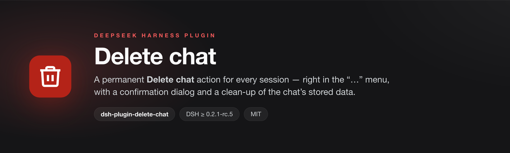
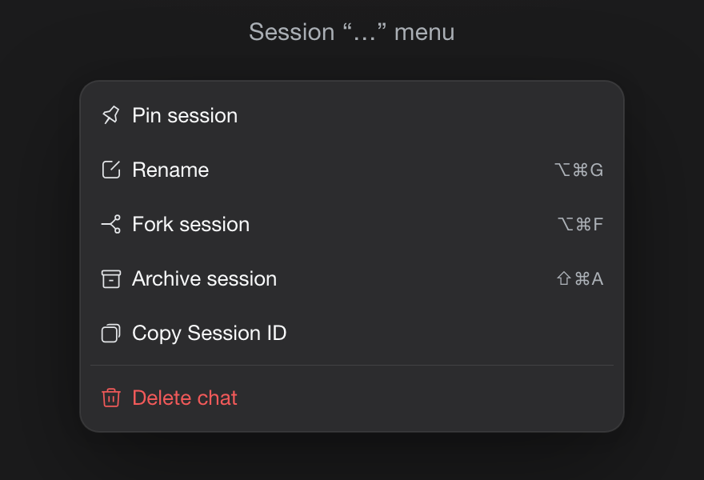
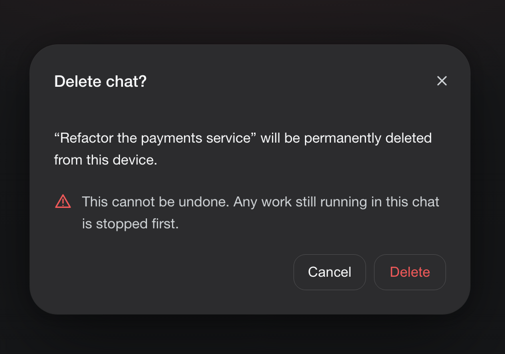

# Delete chat — DSH plugin

<p align="center">
  
</p>

<p align="center">
  <a href="https://www.npmjs.com/package/dsh-plugin-delete-chat"></a>
  
  
</p>

`dsh-plugin-delete-chat` adds a permanent **Delete chat** action to every chat's
"…" menu in the
[DeepSeek Harness](https://github.com/deepseek-ai/deepseek-harness) Web UI, with a
confirmation dialog.

Deleting a chat stops any work still running in it, then permanently removes its
stored data from this device:

- the session log directory under `<DSH_HOME>/sessions/--<project>--/<session-id>/`,
- the derived projection-cache records for that session,

and the row disappears from the sidebar immediately. Files in the chat's
workspace are never touched.

## Screenshots

<p align="center">
  
  &nbsp;&nbsp;
  
</p>

The row sits after the shipped actions and is drawn exactly like the shipped
**Delete workspace** row — error-red label and trash glyph, danger-tinted hover
fill. Confirming opens the host's own dialog style with a clear warning; Delete
then stops running work and removes the chat's stored data.

## Features

- **Chat row menu → Delete chat**, placed after the shipped rows (Pin, Rename,
  Fork, Archive, Copy Session ID) and drawn exactly like the shipped
  **Delete workspace** row: error-red label plus the shipped
  `IconTrashOutlineRegular` trash glyph (same paths, 16×16 viewBox, 1px stroke),
  with the danger-tinted hover/focus fill.
- **Confirmation dialog** in the host's own Modal style with a clear "cannot be
  undone" warning, Cancel/Delete, Escape and a focus trap.
- **Stops running work first** through the same activity seam the shipped
  archive flow uses (in-progress turn, subagents, background jobs, scheduled
  reminders).
- **Immediate row removal** by announcing `api-session/removed` after deletion.
- **Switches to a new chat** if you delete the chat currently open in the main view.
- **English and Chinese** UI, following the app's language setting.
- User-only: no agent tool can delete chats, and subagent chats are refused
  (they are removed with their parent chat).

## Install

Requires DeepSeek Harness `0.2.1-rc.5` or newer (declared in `engines.dsh`).

**In the Harness UI** — open **Plugins → Add plugin**, enter

```
dsh-plugin-delete-chat
```

and confirm. The Host half activates immediately and the "Delete chat" row
appears in the connected page.

**From a plugin market** — add this index source in **Plugins → Discover →
Add index source**:

```
https://eyadagharire.github.io/dsh-plugin-delete-chat/index.json
```

then install the **Delete chat** card. You can also add any other market index
that lists the package.

**From source** — point the plugin manager at the package directory (the
plugin manager's `install_bundle` action accepts its absolute path).

## Uninstall

Disable or remove the bundle in **Settings → Plugins** (or via the plugin
manager). Already deleted chats stay deleted — deletion is permanent.

## Compatibility

Requires DeepSeek Harness `0.2.1-rc.5` or newer (`engines.dsh`). The Host half
needs the `connection`, `webServer`, and `sessionPersistence` services; the
Client half registers into the `sidebar.workspaces.session.menu.item` and
`shell.overlay` slots. Session storage layout follows the shipped JSONL
persistence backend (`<DSH_HOME>/sessions`); `DSH_HOME` defaults to `~/.dsh`.

## Safety

Deletion is permanent and irreversible by design. The action is available only
from the UI after an explicit confirmation; the agent cannot call it.

## License

[MIT](LICENSE).
